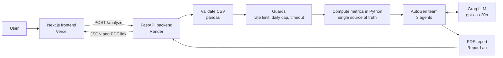
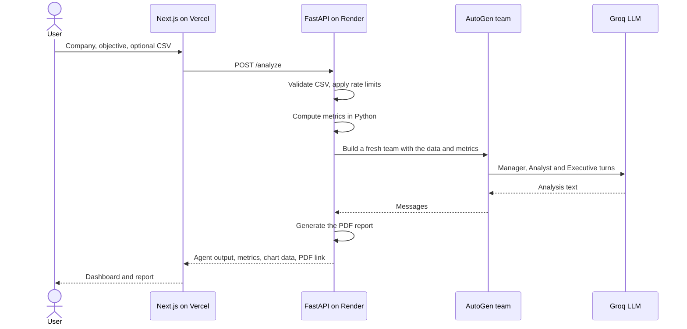

# AI Operations Command Center

**A multi-agent business-intelligence platform.** Three AI agents analyze your business data, then deliver an executive dashboard and a board-ready PDF report.

[](<YOUR_VERCEL_URL>)


> **Live demo:** <YOUR_VERCEL_URL>
> The API runs on a free tier and sleeps when idle, so the **first request can take about a minute** to wake it up.

---

## What it does

Enter a company and a business objective, optionally upload a CSV of your own sales and expenses, and run the analysis. Three AI agents collaborate in sequence:

| # | Agent | Responsibility |
|---|-------|----------------|
| 1 | **Business Manager** | Frames the objective, KPIs and key questions |
| 2 | **Data Analyst** | Interprets trends, strengths and risks in the numbers |
| 3 | **Executive** | Turns the analysis into decisions and next actions |

The result is an interactive dashboard (KPI cards, trend chart, each agent's findings) plus a downloadable PDF report.

## Features

- **Multi-agent analysis** with AutoGen and a Groq-hosted LLM
- **Bring your own data:** upload a CSV (flexible headers, friendly validation errors)
- **Executive dashboard:** animated KPI cards, themed area chart, markdown-rendered agent insights
- **PDF report** generation with ReportLab (KPI summary, performance table, agent analysis)
- **Abuse protection:** per-IP rate limit, daily cap, one analysis at a time, request timeout
- **Honest error handling:** proper HTTP status codes (422, 429, 502, 503, 504), no stack traces to clients
- **Live API status** in the UI, including a "waking up" state for sleeping free-tier servers
- **Responsive and accessible:** works on mobile, keyboard-friendly, respects reduced-motion

## Architecture



### Request lifecycle



## Engineering notes

Problems I hit while building this, and how they were solved:

- **The third agent never spoke.** AutoGen counts the initial task as a message, so `MaxMessageTermination(3)` stopped the conversation before the Executive. The limit is now 4 (task + 3 agents).
- **The LLM got the arithmetic wrong.** The analyst reported different totals than the PDF's own tables. All numbers are now computed in Python (`compute_metrics`) and injected into the prompts as ground truth. The agents interpret; they never calculate. The PDF uses the same function, so the report can't contradict itself.
- **An agent returned an empty message.** With a 1000-token cap, the reasoning model appeared to spend its whole budget before producing visible text. The token budget was raised and reasoning effort lowered.
- **State leaked between requests.** AutoGen teams are stateful and cannot run concurrently, so a fresh team is built for every request.
- **Untrusted CSV data reaches an LLM prompt.** User column headers never enter prompts, and period labels are sanitized and truncated. Files are validated before any quota or LLM time is spent.
- **Errors must not leak internals.** Typed exceptions are mapped to HTTP status codes with safe messages; tracebacks stay in server logs.

## Tech stack

| Layer | Technology |
|-------|-----------|
| Frontend | Next.js 16 (App Router), React 19, Tailwind CSS 4, Recharts, Framer Motion, Lucide |
| Backend | FastAPI, Pydantic, pandas, ReportLab |
| AI | AutoGen (`autogen-agentchat` 0.7.5), Groq (`openai/gpt-oss-20b`) |
| Hosting | Vercel (frontend), Render (backend) |

## Using your own data

Upload a `.csv` file (up to 60 rows and 200 KB) with a header row. Column names are matched flexibly:

| Field | Accepted headers (case-insensitive) | Required |
|-------|--------------------------------------|----------|
| Period | `period`, `month`, `date`, `quarter`, `week`, `year` | No (defaults to Period 1, 2, ...) |
| Sales | `sales`, `revenue`, `income`, `turnover` | Yes |
| Expenses | `expenses`, `costs`, `cost`, `spend` | Yes |

```csv
period,sales,expenses
Jan 2026,48200,41500
Feb 2026,51800,43200
Mar 2026,56400,47100
```

Profit and margin are always computed for you. Currency symbols and thousands separators (`$1,200`) are handled. A sample file can be downloaded from the app.

## API

| Method | Path | Description |
|--------|------|-------------|
| `POST` | `/analyze` | Run an analysis |
| `GET` | `/health` | Health check |
| `GET` | `/docs` | Interactive API documentation |
| `GET` | `/reports/<file>.pdf` | Download a generated report |

**Request**

```json
{
  "company_name": "Acme Inc.",
  "objective": "Improve profitability",
  "csv_data": "period,sales,expenses\nJan,1000,800\nFeb,1500,1200"
}
```

`csv_data` is optional; without it the built-in sample dataset is used.

**Response (200)**

```json
{
  "status": "success",
  "agents": [{ "agent": "business_manager", "response": "..." }],
  "metrics": { "total_sales": 13500, "total_profit": 2700, "profit_margin_pct": 20.0 },
  "monthly": [{ "month": "January", "sales": 1000, "expenses": 800, "profit": 200, "margin": 20.0 }],
  "pdf": "/reports/Business_Intelligence_Report_ab12cd34ef56.pdf",
  "data_source": "sample",
  "rows": 6
}
```

**Status codes:** `422` invalid input or CSV, `429` rate or daily limit reached, `502` agents failed, `503` busy, `504` timed out.

## Getting started

**Prerequisites:** Python 3.14 (the version this project is developed with), Node.js 20.9+, and a free [Groq API key](https://console.groq.com).

```bash
git clone https://github.com/<YOUR_GITHUB_USERNAME>/<YOUR_REPO_NAME>.git
cd <YOUR_REPO_NAME>
```

**Backend**

```bash
python -m venv venv
# Windows:        venv\Scripts\activate
# macOS / Linux:  source venv/bin/activate

pip install -r requirements.txt
```

Create a `.env` file in the project root (see `.env.example`):

```
GROQ_API_KEY=your_groq_api_key_here
```

```bash
python app.py
```

The API runs at http://127.0.0.1:8000 (docs at `/docs`).

**Frontend** (in a second terminal)

```bash
cd frontend
npm install
```

Create `frontend/.env.local`:

```
NEXT_PUBLIC_API_URL=http://127.0.0.1:8000
```

```bash
npm run dev
```

Open http://localhost:3000.

## Configuration

**Backend** (environment variables)

| Variable | Default | Purpose |
|----------|---------|---------|
| `GROQ_API_KEY` | none (required) | Groq API key |
| `ALLOWED_ORIGINS` | `http://localhost:3000,http://127.0.0.1:3000` | Comma-separated CORS origins, exact match, no trailing slash |
| `ALLOWED_ORIGIN_REGEX` | none | Optional regex for extra origins (e.g. preview deployments) |
| `RATE_LIMIT_PER_HOUR` | `5` | Analyses per IP per hour |
| `DAILY_LIMIT` | `100` | Total analyses per day |
| `MAX_CONCURRENT` | `1` | Simultaneous analyses |
| `ANALYSIS_TIMEOUT_SECONDS` | `120` | Max time for the agents |

**Frontend**

| Variable | Purpose |
|----------|---------|
| `NEXT_PUBLIC_API_URL` | Base URL of the backend (no trailing slash). Set at build time. |

## Deployment

- **Backend (Render):** Python web service. Build `pip install -r requirements.txt`, start `uvicorn app:app --host 0.0.0.0 --port $PORT`, health check `/health`. Set `GROQ_API_KEY`, `PYTHON_VERSION` and `ALLOWED_ORIGINS` (your Vercel URL).
- **Frontend (Vercel):** import the repo, set the root directory to `frontend`, and set `NEXT_PUBLIC_API_URL` to the Render URL.

## Project structure

```
.
├── app.py               # FastAPI app: routes, CORS, request guards
├── agents.py            # AutoGen agents and Groq client
├── services.py          # Orchestration: team, PDF, response
├── business_data.py     # Sample data, CSV parsing, verified metrics
├── guards.py            # Rate limiter, daily cap, client IP
├── report_generator.py  # PDF report (ReportLab)
├── schemas.py           # Request / response models
├── requirements.txt
├── .env.example
└── frontend/
    ├── app/             # Next.js pages and global styles
    ├── components/      # layout/ and dashboard/ components
    └── lib/             # API client, formatting, helpers
```

## Limitations

- The default analysis uses a small **built-in sample dataset**; upload a CSV to analyze your own numbers.
- On the free hosting tier the server **sleeps when idle** (first request is slow) and **generated PDFs are not persisted** across restarts.
- Rate limiting is **in memory**: it resets on restart, and the per-IP part relies on a header that can be spoofed. The daily cap and a provider-side spending limit are the real safety nets.
- **Uploaded data is sent to Groq** for analysis. Do not upload confidential data.
- LLM output varies between runs. All figures are computed in code, but the written commentary is AI-generated and is not financial advice.
- No authentication or per-user history yet.

## Roadmap

- [ ] Automated tests and CI
- [ ] Live agent progress (streaming) in the UI
- [ ] Persistent report storage
- [ ] User accounts and analysis history
- [ ] More chart types and richer CSV schemas

## License

Released under the MIT License. See [LICENSE](LICENSE).

## Author

**<YOUR NAME>**: [LinkedIn](<YOUR_LINKEDIN_URL>) · [GitHub](https://github.com/<YOUR_GITHUB_USERNAME>)
